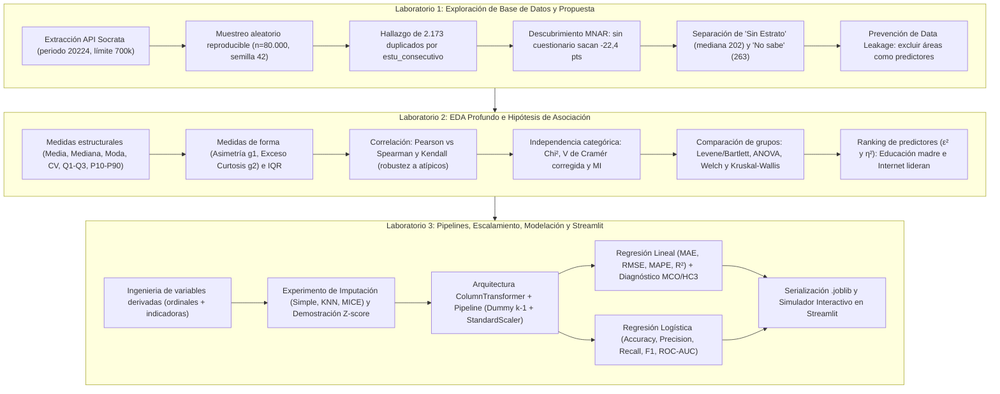

# 01 · Guía General y Continuidad Metodológica (Laboratorios 1, 2 y 3)

**Especialización en Analítica Estratégica de Datos · Estadística para Analítica de Datos · UPTC**  
**Profesor:** Duván Cataño · **Integrantes:** Juan Beltrán · Daniel Castellanos · Daniel Rico  

---

## 1. Visión Integral del Proyecto: El Ciclo Completo de Analítica de Datos

El desarrollo de este proyecto aplica una metodología rigurosa y progresiva a lo largo de tres laboratorios consecutivos sobre el conjunto de datos **Resultados únicos Saber 11 (ICFES)** del portal de Datos Abiertos de Colombia (`kgxf-xxbe`, periodo `20224`). En lugar de tratar cada entrega como un ejercicio aislado, cada laboratorio construye los cimientos estadísticos y computacionales del siguiente:

---

## 2. Trazabilidad Detallada: ¿Cómo se aplica en el Laboratorio 3 lo hecho en los Laboratorios 1 y 2?

La siguiente matriz documenta **qué se descubrió o decidió en los Laboratorios 1 y 2**, **por qué fue importante** y **cómo se implementó exactamente en el Laboratorio 3**:

| Hallazgo / Decisión en Laboratorios 1 y 2 | ¿Para qué sirve estadísticamente? | ¿Cómo se aplica en el Laboratorio 3? |
|---|---|---|
| **1. Muestra reproducible (`n = 80.000`, `random_state = 42`) sobre `periodo = 20224`** | Garantiza que las métricas descriptivas, los $p$-valores de las pruebas de hipótesis y los errores de predicción se calculen sobre la misma cohorte poblacional. | El módulo [`src/datos.py`](src/datos.py) lee exactamente el archivo `data/saber11_muestra_20224.csv` generado en los laboratorios previos. |
| **2. Eliminación de $2.173$ duplicados (`2,7163 %`) por `estu_consecutivo`** | Evita que un estudiante repetido tenga doble peso en la función de pérdida y, sobre todo, **impide que una copia caiga en `X_train` y la otra en `X_test`** (fuga de información entre entrenamiento y prueba). | Se ejecuta `df.drop_duplicates(subset='estu_consecutivo')` en `datos.depurar()`, obteniendo exactamente **$77.827$ estudiantes únicos** antes de cualquier partición `train_test_split`. |
| **3. Mecanismo MNAR (*Missing Not At Random*) en `fami_estratovivienda`, `fami_educacionmadre` y `fami_tieneinternet`** | En el Lab 1 se descubrió que quienes dejan en blanco estas variables obtienen **~22,4 puntos menos** en promedio ($228{,}8$ vs $251{,}2$). Borrar esas filas sesgaría el modelo hacia arriba; imputar con la moda ocultaría su vulnerabilidad. | Se conserva la categoría explícita `'Desconocido'` en las variables categóricas. En el modelo lineal, el coeficiente de `cat__fami_tieneinternet_Desconocido` resulta ser **$-10{,}1291$ puntos** ($p < 0.0001$), capturando limpiamente el efecto de no diligenciar el cuestionario. |
| **4. Comportamiento opuesto de categorías especiales: `Sin Estrato` (mediana $202$) vs `No sabe` en educación materna (mediana $263$)** | En el Diccionario del Lab 1 se demostró que `Sin Estrato` y `No sabe` no están en la escala ordinal pero tampoco equivalen a un dato vacío (`NaN`). | Se construyen las variables indicadoras `es_sin_estrato` y `educ_no_sabe` en `datos.agregar_variables_derivadas()`, mientras que las escalas ordinales (`estrato_num` 1–6 y `educ_madre_nivel` 0–9) pasan por el `num_pipeline` (`SimpleImputer('median')` + `StandardScaler()`). Así se elimina la multicolinealidad ($\text{VIF} \le 1{,}4018$). |
| **5. Conservación de los $133$ valores atípicos ($0{,}1650\\%$) de `punt_global` detectados por $1{,}5\cdot\text{IQR}$** | En los Labs 1 y 2 se comprobó que los puntajes fuera de $[94{,}5;\; 402{,}5]$ están dentro de la escala oficial del ICFES ($12$ a $477$) y corresponden a desempeños extremos reales, no a errores de digitación. | Se mantienen el $100\\%$ de los estudiantes únicos ($77.827$) en el entrenamiento y evaluación, garantizando que el modelo sea válido en todo el espectro de desempeño nacional. |
| **6. Violación de homocedasticidad entre grupos detectada con la prueba de Levene en el Lab 2 ($p < 0.0001$)** | En el Lab 2 se vio que la dispersión del puntaje varía entre niveles educativos y estratos, lo que obligó a usar **ANOVA de Welch** y **Kruskal-Wallis** en lugar de confiar ciegamente en el ANOVA clásico. | En el Laboratorio 3, al diagnosticar el modelo de Regresión Lineal con la **Prueba de Breusch-Pagan** ($\text{LM} = 183{,}8730$, $p < 0.0001$), se confirma la heterocedasticidad residual y se implementa la matriz de covarianza robusta de **White-MacKinnon (`HC3`)** en `statsmodels.OLS`. |
| **7. No linealidad en los estratos altos (Estratos 5 y 6 caen en mediana respecto al Estrato 4)** | En el Lab 1 (§7.2.3) y Lab 2 se documentó que la mediana sube de Estrato 1 ($238$) a Estrato 4 ($270$), pero baja en Estrato 5 ($266$) y Estrato 6 ($229$), mientras que la educación materna sí sube monótonamente de `Ninguno` ($204$) a `Postgrado` ($314$). | Explica por qué en la regresión múltiple el coeficiente estandarizado de `educ_madre_nivel` es fuertemente positivo (**$+13{,}0018$ pts**), mientras que el efecto parcial lineal residual de `estrato_num` es pequeño (**$-0{,}5848$ pts**) una vez controlados la educación materna, el internet y el tipo de colegio. |
| **8. Advertencia de Fuga de Información (*Data Leakage*) con los puntajes por prueba** | `punt_global` se calcula matemáticamente a partir de `punt_matematicas`, `punt_lectura_critica`, `punt_sociales_ciudadanas`, `punt_c_naturales` y `punt_ingles`. Usar las 5 áreas como predictores daría $R^2 \approx 0.9999$ sin valor analítico real. | Se diseñan dos modelos diferenciados: el **Modelo A (Socioeconómico Puro)** que excluye todos los puntajes de prueba ($R^2 = 0.1888$, cuantificación pura de brechas de origen) y el **Modelo B (Académico Ampliado)** que incluye únicamente la competencia transversal `punt_ingles` ($R^2 = 0.6541$) para demostrar imputación numérica real y ganancia predictiva. |

---

## 3. Mapa de Módulos de Código (`src/`) y su Propósito

Siguiendo la arquitectura modular introducida en `lab2_saber11`, toda la lógica computacional está desacoplada en cuatro módulos dentro de `src/` que son consumidos tanto por el Jupyter Notebook como por la aplicación de Streamlit:

### 3.1 [`src/datos.py`](src/datos.py) — Extracción, Depuración e Ingeniería de Características
- **¿Qué hace?** Gestiona la descarga desde la API Socrata o la lectura desde caché local (`data/saber11_muestra_20224.csv`), ejecuta la limpieza reproducible y genera las columnas derivadas para regresión y clasificación.
- **¿Cómo lo hace?**
  - `cargar_muestra_cruda()`: Lee las $80.000$ filas crudas.
  - `depurar(crudo)`: Elimina duplicados por `estu_consecutivo`, calcula el indicador `sin_cuestionario`, recodifica los vacíos cualitativos como `'Desconocido'` y llama a `agregar_variables_derivadas()`.
  - `agregar_variables_derivadas(df)`: Crea `estrato_num` ($1$ a $6$), `educ_madre_nivel` ($0$ a $9$), `es_sin_estrato` (`'Si'`/`'No'`), `educ_no_sabe` (`'Si'`/`'No'`), `supera_promedio` ($1$ si $\text{punt\_global} \ge 250$, $0$ si $< 250$) y `alto_desempeno` ($1$ si $\text{punt\_global} \ge 300$).
- **¿Para qué sirve?** Asegura que el Notebook de entrenamiento y el simulador en vivo de Streamlit apliquen exactamente las mismas reglas de transformación sin duplicar código.

### 3.2 [`src/estadistica.py`](src/estadistica.py) — EDA, Diagnóstico de Faltantes y Pruebas de Hipótesis
- **¿Qué hace?** Calcula todas las tablas estadísticas descriptivas, pruebas de hipótesis paramétricas/no paramétricas y experimentos de imputación y escalamiento.
- **¿Cómo lo hace?**
  - `evaluar_mecanismo_faltantes(crudo)`: Contrasta con $t$ de Welch y Mann-Whitney la diferencia de puntaje entre registros con dato y sin dato (demostración MNAR).
  - `comparar_imputacion_numerica(df)`: Evalúa `SimpleImputer(mean)`, `SimpleImputer(median)`, `KNNImputer(k=5)` e `IterativeImputer(MICE)` ocultando el $20\\%$ de los datos y midiendo RMSE y MAE.
  - `demostracion_escalamiento_distancias(df)`: Calcula distancias euclidianas entre perfiles de estudiantes sin escalar, con `StandardScaler` y con `MinMaxScaler`.
  - `descriptivas()`, `impacto_outliers()`, `tabla_correlaciones()`, `independencia_categoricas()`, `analisis_mixto()`, `ranking_asociacion()`: Reproducen y amplían todos los contrastes estadísticos del Laboratorio 2.

### 3.3 [`src/modelos.py`](src/modelos.py) — Pipelines, Entrenamiento, Inferencia OLS y Serialización
- **¿Qué hace?** Construye los `ColumnTransformer` y `Pipeline`, entrena y evalúa los modelos de Regresión Lineal y Regresión Logística, ejecuta el diagnóstico econométrico en `statsmodels` y guarda los artefactos `.joblib`.
- **¿Cómo lo hace?**
  - `construir_preprocesador()`: Encadena imputación + `OneHotEncoder(drop='first')` para categóricas e imputación mediana + `StandardScaler()` para numéricas.
  - `entrenar_evaluar_regresion()`: Ajusta `LinearRegression()`, calcula **MAE, RMSE, MAPE, $R^2$, $R^2_{\text{ajustado}}$ y RSE** en entrenamiento y prueba, corre validación cruzada $k=10$ (`cross_validate`) y llama a `ajustar_ols_statsmodels()` para obtener la tabla de inferencia MCO/HC3, el **VIF**, la prueba de **Jarque-Bera** y la prueba de **Breusch-Pagan**.
  - `entrenar_evaluar_logistica()`: Ajusta `LogisticRegression()`, ejecuta validación cruzada estratificada $k=10$ (`StratifiedKFold`), optimiza hiperparámetros con `RandomizedSearchCV`, calcula **Accuracy, Precision, Recall, F1-score y ROC-AUC**, y extrae los *Log-Odds* y *Odds Ratios* ($e^{\beta_j}$).
  - `entrenar_y_guardar_modelos_finales()`: Serializa los 4 pipelines en `models/*.joblib` y exporta `models/metricas_resumen.json`.

### 3.4 [`src/graficos.py`](src/graficos.py) — Visualizaciones Estáticas e Interactivas
- **¿Qué hace?** Genera todas las figuras en formato Matplotlib/Seaborn (con la paleta institucional UPTC: amarillo `#FFC000` y negro `#222222`) para el Notebook y las figuras interactivas en **Plotly** para la aplicación de Streamlit.

