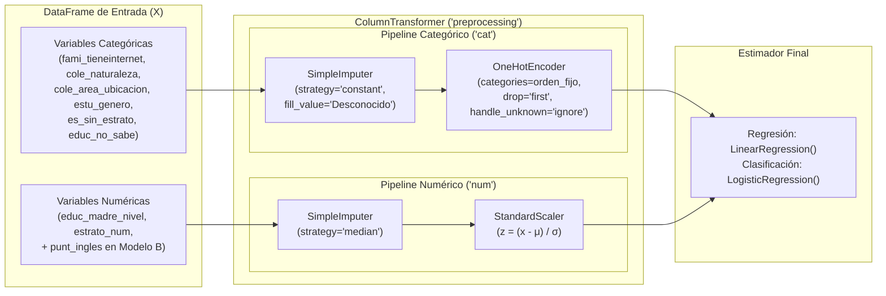

# 03 · Limpieza, Imputación, Escalamiento y Construcción de Pipelines

**Especialización en Analítica Estratégica de Datos · Estadística para Analítica de Datos · UPTC**  
**Profesor:** Duván Cataño · **Integrantes:** Juan Beltrán · Daniel Castellanos · Daniel Rico  

---

## 1. Protocolo de Limpieza y Depuración (`src/datos.py`)

### 1.1 Eliminación de Duplicados Operacionales
- **¿Qué se hace?** Se eliminan los registros que repiten el identificador único del estudiante (`estu_consecutivo`) mediante `df.drop_duplicates(subset='estu_consecutivo')`.
- **¿Por qué se hace?** En la muestra aleatoria de $80.000$ registros extraída del periodo `20224`, existen exactamente **$2.173$ filas duplicadas ($2{,}7163\\%$)**, quedando **$77.827$ estudiantes únicos**. Como se demostró en el Laboratorio 1, esta duplicación proviene de la tabla fuente en Datos Abiertos.
- **Impacto crítico en Machine Learning:** Si no se eliminan los duplicados antes de `train_test_split`, una copia de un mismo estudiante puede caer en el conjunto de entrenamiento (`X_train`) y su copia idéntica en el conjunto de prueba (`X_test`), contaminando la evaluación fuera de muestra.

---

## 2. Tratamiento de Valores Faltantes: MNAR vs Imputación Numérica (Notebook 6)

### 2.1 Diagnóstico Estadístico del Mecanismo MNAR en Variables Socioeconómicas
En la muestra depurada de $77.827$ estudiantes únicos, los valores faltantes se concentran en cuatro columnas:
- `fami_estratovivienda`: **$5.288$ faltantes ($6{,}7946\\%$)**
- `fami_tieneinternet`: **$4.649$ faltantes ($5{,}9735\\%$)**
- `fami_educacionmadre`: **$4.568$ faltantes ($5{,}8694\\%$)**
- `punt_ingles`: **$282$ faltantes ($0{,}3623\\%$)**

Para determinar cómo tratar las ausencias en las variables familiares (`fami_*`), se contrasta en [`src/estadistica.py`](src/estadistica.py) (`evaluar_mecanismo_faltantes`) la hipótesis nula $H_0: \mu_{\text{con dato}} = \mu_{\text{sin dato}}$ mediante la prueba $t$ de Welch y la prueba no paramétrica $U$ de Mann-Whitney:

| Variable con Faltantes | $n$ Faltantes | % Faltantes | Media Con Dato | Media Sin Dato | Diferencia ($\Delta\bar{Y}$) | Estadístico $t$ de Welch | $p$-valor ($t$ Welch / Mann-Whitney) |
|---|---:|---:|---:|---:|---:|---:|---:|
| `fami_estratovivienda` | `5.288` | `6.7946 %` | `251.3765` | `229.7549` | **`-21.6216`** | `31.6441` | `< 0.0001` |
| `fami_tieneinternet` | `4.649` | `5.9735 %` | `251.2464` | `228.8361` | **`-22.4103`** | `30.8926` | `< 0.0001` |
| `fami_educacionmadre` | `4.568` | `5.8694 %` | `251.2248` | `228.8229` | **`-22.4019`** | `30.6385` | `< 0.0001` |
| `punt_ingles` | `282` | `0.3623 %` | `250.0033` | `223.8191` | **`-26.1842`** | `8.5997` | `< 0.0001` |

**Conclusión metodológica:**
Los datos ausentes en el bloque socioeconómico **no faltan completamente al azar (no son MCAR)**; corresponden a un mecanismo **MNAR (*Missing Not At Random*)** donde $4.370$ estudiantes no diligenciaron el formulario socioeconómico y presentan un déficit sistemático superior a $22$ puntos. Por tanto:
1. **No se eliminan filas (*listwise deletion*)**, pues excluiría al $7{,}21\\%$ más vulnerable de la muestra.
2. **No se imputan las categóricas con la moda (`most_frequent`)**, pues asignaría artificialmente `Estrato 2`, `Secundaria completa` y `Si tiene internet` a hogares con puntajes muy inferiores.
3. **Se codifican explícitamente como `'Desconocido'`**, permitiendo que los modelos lineales y logísticos estimen un parámetro propio para la ausencia de información.

---

### 2.2 Experimento Comparativo de Imputación en Variables Cuantitativas (Notebook 6)
Siguiendo el **Notebook 6 (`6.Imputacion.ipynb`)** del profesor Duván Cataño, se evalúan cuatro algoritmos de imputación numérica sobre las variables cuantitativas continuas de desempeño, simulando un $20\\%$ de valores perdidos en una submuestra de $n = 3.000$ estudiantes (`comparar_imputacion_numerica`):

1. **Imputación por Media (`SimpleImputer(strategy='mean')`):** Reemplaza cada `NaN` por $\bar{x}_j$. Es rápida, pero distorsiona la varianza y crea un pico artificial en el centro de la distribución.
2. **Imputación por Mediana (`SimpleImputer(strategy='median')`):** Reemplaza cada `NaN` por $Q_2(x_j)$. Es más robusta frente a colas asimétricas (como `punt_ingles`, que tiene $g_1 = 0{,}5065$).
3. **Imputación por $K$-Vecinos Más Cercanos (`KNNImputer(n_neighbors=5)`):** Busca los $k=5$ estudiantes más cercanos en el espacio euclidiano de las demás variables observadas y promedia sus valores.
4. **Imputación Iterativa tipo MICE (`IterativeImputer(random_state=42)`):** Modela cada variable con faltantes como función lineal regresiva de las demás en ecuaciones encadenadas hasta converger.

#### Resultados Empíricos del Experimento (20 % de datos enmascarados, $n = 3.000$):

| Método de Imputación | RMSE (Puntos, escala 0–100) | MAE (Puntos, escala 0–100) | Preservación de Densidad KDE |
|---|---:|---:|---|
| **1. Iterativa tipo MICE (`IterativeImputer`)** | **`7.2706`** | **`5.7897`** | Excelente: reproduce media, varianza y colas sin picos artificiales. |
| **2. Vecinos Cercanos (`KNNImputer`, $k=5$)** | `7.8922` | `6.2654` | Muy buena: conserva la estructura multimodal y la dispersión. |
| **3. Media (`SimpleImputer('mean')`)** | `11.9320` | `9.6696` | Deficiente con 20 % de vacíos: contrae la desviación estándar. |
| **4. Mediana (`SimpleImputer('median')`)** | `11.9647` | `9.6660` | Robusta a extremos, pero concentra masa en la mediana si el % de vacíos es alto. |

> **Aplicación en el Pipeline del Modelo B:** Cuando predecimos `punt_global` sin usar los otros cuatro puntajes de área (para no incurrir en *data leakage*), `punt_ingles` solo tiene **$282$ faltantes ($0{,}3623\\%$)** sobre $77.827$ estudiantes. Con una proporción tan pequeña ($< 0{,}4\\%$), incluir `SimpleImputer(strategy='median')` en el `num_pipeline` no altera la densidad KDE en absoluto, evita depender de otras pruebas del examen y garantiza velocidad de inferencia inmediata en Streamlit.

---

## 3. Codificación de Categóricas y Escalamiento de Numéricas (Notebook 7)

### 3.1 Codificación *Dummy* ($k-1$) vs *One-Hot Encoding* ($k$)
Sea una variable categórica $X$ con $k$ niveles posibles:
- **One-Hot Encoding ($k$ columnas):** Crea $O_j \in \{0, 1\}$ para $j = 1, \dots, k$. Como $\sum_{j=1}^k O_j = 1$ para todas las filas, la suma de las $k$ columnas es idéntica a la columna constante del intercepto ($\beta_0$). En una regresión lineal o logística sin penalización, esto hace que la matriz $X^T X$ sea singular (**trampa de las variables dummy**).
- **Codificación Dummy ($k-1$ columnas, `drop='first'`):** Elimina la primera categoría (que pasa a ser el **nivel base o de referencia** absorbido en $\beta_0$) y genera $D_j \in \{0, 1\}$ para $j = 2, \dots, k$. Cada coeficiente $\beta_j$ se interpreta directamente como la diferencia promedio en la respuesta respecto a la categoría de referencia.

En [`src/modelos.py`](src/modelos.py) (`construir_preprocesador`), se especifica explícitamente el orden de categorías en `OneHotEncoder(categories=..., drop='first')` para que las categorías de referencia tengan sentido sustantivo inmediato:

| Variable Categórica | Categoría Base (`drop='first'`) | Columnas Dummy Generadas ($k-1$) |
|---|---|---|
| `fami_tieneinternet` | `'No'` (Sin internet en casa) | `cat__fami_tieneinternet_Si`, `cat__fami_tieneinternet_Desconocido` |
| `cole_naturaleza` | `'NO OFICIAL'` (Colegio privado) | `cat__cole_naturaleza_OFICIAL` |
| `cole_area_ubicacion` | `'RURAL'` (Zona rural) | `cat__cole_area_ubicacion_URBANO` |
| `estu_genero` | `'F'` (Femenino) | `cat__estu_genero_M` |
| `es_sin_estrato` | `'No'` (En escala E1–E6 o Desconocido) | `cat__es_sin_estrato_Si` |
| `educ_no_sabe` | `'No'` (Nivel educativo reportado o Desconocido) | `cat__educ_no_sabe_Si` |

---

### 3.2 Escalamiento: Estandarización ($Z$-score) vs Normalización (Min-Max)
Las variables numéricas del proyecto se encuentran en escalas numéricas muy diferentes:
- `estrato_num`: rango $[1, 6]$ ($\mu = 2{,}12$, $\sigma = 1{,}00$)
- `educ_madre_nivel`: rango $[0, 9]$ ($\mu = 4{,}44$, $\sigma = 2{,}30$)
- `punt_ingles`: rango $[0, 100]$ ($\mu = 50{,}16$, $\sigma = 12{,}77$)

Se consideran las dos transformaciones estudiadas en el **Notebook 7 (`7.Pipeline_Escalamiento.ipynb`)**:
1. **Estandarización (`StandardScaler`):**
   $$z = \frac{x - \mu}{\sigma} \implies \bar{z} = 0, \quad s_z = 1$$
2. **Normalización (`MinMaxScaler`):**
   $$w = \frac{x - x_{\min}}{x_{\max} - x_{\min}} \in [0, 1]$$

#### Demostración Matemática con Perfiles Reales de Saber 11 (`demostracion_escalamiento_distancias`)
Considérense tres estudiantes definidos por el vector $P_i = [\text{educ\_madre\_nivel},\; \text{punt\_ingles}]$:
- **Estudiante A ($P_1$):** Madre con primaria incompleta ($1{,}0$) y puntaje en inglés de $45{,}0$.
- **Estudiante B ($P_2$):** Madre con primaria completa ($2{,}0$) y puntaje en inglés de $60{,}0$.
- **Estudiante C ($P_3$):** Madre con posgrado ($9{,}0$) y puntaje en inglés de $47{,}0$.

| Par de Perfiles | Distancia Euclidiana Sin Escalar | Distancia con `StandardScaler` ($Z$-score) | Distancia con `MinMaxScaler` $[0,1]$ | Interpretación del Cambio |
|---|---:|---:|---:|---|
| $d(P_1, P_2)$ | `15.0333` | **`1.3067`** | `0.1865` | Sin escalar parecía el par más lejano por los $15$ pts de inglés; estandarizado es el par más cercano ($1{,}31\,\sigma$). |
| $d(P_1, P_3)$ | `8.2462` | **`3.4800`** | `0.8891` | Sin escalar parecía cercano ($8{,}25$); al estandarizar se revela la enorme brecha de $8$ niveles educativos maternos ($3{,}48\,\sigma$). |
| $d(P_2, P_3)$ | `14.7648` | **`3.2102`** | `0.7885` | Confirma la distancia estructural entre un hogar con primaria y uno con posgrado. |

---

## 4. Arquitectura del `ColumnTransformer` y `Pipeline` (`src/modelos.py`)



### Implementación Exacta en Código (`src/modelos.py`)
```python
cat_pipeline = Pipeline([
    ("imputer", SimpleImputer(strategy="constant", fill_value="Desconocido")),
    ("onehot", OneHotEncoder(
        categories=categorias_orden,
        drop="first",
        handle_unknown="ignore",
        sparse_output=False
    )),
])

num_pipeline = Pipeline([
    ("imputer", SimpleImputer(strategy="median")),
    ("scaler", StandardScaler()),
])

preprocessor = ColumnTransformer([
    ("cat", cat_pipeline, cat_cols),
    ("num", num_pipeline, num_cols),
])

model = Pipeline([
    ("preprocessing", preprocessor),
    ("regressor", LinearRegression()),  # o ("model", LogisticRegression(...))
])
```

### ¿Por qué esta arquitectura es óptima?
1. **Cero *Data Leakage* en Validación Cruzada:** Cuando `cross_validate(model, X, y, cv=10)` divide los datos en $10$ pliegues, en cada iteración ajusta la mediana del `SimpleImputer` y la media/desviación del `StandardScaler` únicamente con el $90\\%$ de entrenamiento, transformando limpiamente el $10\\%$ de validación.
2. **Despliegue directo en producción (`.joblib`):** El archivo `model_linear_regression.joblib` contiene tanto las reglas de transformación como los pesos $\hat{\beta}$. En Streamlit basta invocar `pipe.predict(df_usuario)` sobre los datos crudos del usuario sin necesidad de re-escalar ni crear dummies manualmente.

