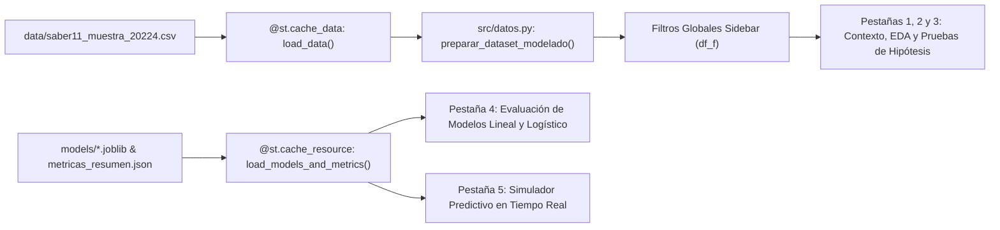

# 06 — Manual Técnico y de Usuario de la Aplicación Interactiva Streamlit

Este documento describe en detalle el **Entregable 2** del **Laboratorio 3**: la aplicación web interactiva desarrollada en [`app/streamlit_app.py`](file:///c:/Users/beltr/Documents/Universidad/Estadistica/Laboratorio%203/app/streamlit_app.py). Explica su arquitectura de software, cómo reutiliza y extiende la aplicación construida en el **Laboratorio 2** (`lab2_saber11/app/streamlit_app.py`) y los scripts del curso (`src/housing_pred_stream.py`, `src/estrato_eda.py`), cómo ejecutarla y cómo funciona su motor de predicción en tiempo real.

---

## 1. Cumplimiento de los Requerimientos de `Laboratorio_3.pdf`

El documento guía de la asignatura establece para el **Entregable 2 — Aplicación en Streamlit**:
1. **Descripción del proyecto:** Contexto institucional del examen ICFES Saber 11 (Periodo `20224`), trazabilidad con los Laboratorios 1 y 2, y métricas globales de la muestra depurada ($77,827$ estudiantes únicos).
2. **Visualizaciones interactivas:** Gráficos dinámicos en Plotly y Matplotlib/Seaborn que se actualizan en tiempo real según los filtros del usuario.
3. **Predicciones con el modelo entrenado:** Carga directa de los pipelines serializados (`.joblib`) de **Regresión Lineal** y **Regresión Logística** (tanto para el **Modelo A — Socioeconómico Puro** como para el **Modelo B — Socioeconómico + Inglés**) para estimar simultáneamente el `punt_global` esperado y la probabilidad $P(\text{punt\_global} \ge 250)$.
4. **Inputs para el usuario:** Controles interactivos en la barra lateral (filtros globales de exploración) y un formulario completo de simulación individual con listas desplegables, controles deslizantes (*sliders*) y desglose aditivo del aporte de cada variable.

---

## 2. Cómo Ejecutar la Aplicación

Desde una terminal ubicada en la raíz del proyecto (`C:\Users\beltr\Documents\Universidad\Estadistica\Laboratorio 3`), ejecute:

```powershell
streamlit run app/streamlit_app.py
```

La aplicación abrirá automáticamente una pestaña en el navegador predeterminado en la dirección `http://localhost:8501`.

> [!TIP]
> **Autogeneración Resiliente de Modelos:** Si por alguna razón la carpeta `models/` no contuviera los archivos `.joblib` o el resumen `metricas_resumen.json`, la función [`load_models_and_metrics()`](file:///c:/Users/beltr/Documents/Universidad/Estadistica/Laboratorio%203/app/streamlit_app.py#L46-L65) invoca automáticamente `entrenar_y_guardar_modelos_finales(df)` de [`src/modelos.py`](file:///c:/Users/beltr/Documents/Universidad/Estadistica/Laboratorio%203/src/modelos.py#L387-L448), entrenando y serializando los cuatro pipelines en el acto sin arrojar errores al usuario.

---

## 3. Arquitectura Técnica y Optimización de Rendimiento

La aplicación está estructurada de forma modular apoyándose en los cuatro módulos del paquete [`src/`](file:///c:/Users/beltr/Documents/Universidad/Estadistica/Laboratorio%203/src/__init__.py):



### 3.1 Estrategia de Caché en Dos Niveles
- **`@st.cache_data(show_spinner=False)` en `load_data()`:** Carga el archivo CSV de $80,000$ registros, ejecuta la deduplicación por `estu_consecutivo` ($77,827$ únicos) y construye todas las variables de ingeniería (`supera_promedio`, `educ_madre_nivel`, `estrato_num`, `es_sin_estrato`, `educ_no_sabe`, `bloque_mnar`) una única vez en memoria RAM.
- **`@st.cache_resource(show_spinner=False)` en `load_models_and_metrics()`:** Carga en memoria los $4$ objetos `Pipeline` serializados con `joblib` (`model_linear_regression.joblib`, `model_linear_academico.joblib`, `model_logistic_regression.joblib`, `model_logistic_academico.joblib`), sus listas de características (`features_*.joblib`) y el diccionario precalculado `metricas_resumen.json`. De este modo, cambiar de pestaña o mover un *slider* responde en milisegundos sin reentrenar modelos.

---

## 4. Recorrido Detallado por la Interfaz (Barra Lateral y 5 Pestañas)

### 4.1 Barra Lateral (`st.sidebar`): Filtros Globales de Subpoblación
Permite filtrar dinámicamente los $77,827$ estudiantes únicos según:
1. **Naturaleza del Colegio (`cole_naturaleza`):** Selección múltiple (`OFICIAL`, `NO OFICIAL`).
2. **Área de Ubicación (`cole_area_ubicacion`):** Selección múltiple (`URBANO`, `RURAL`).
3. **Acceso a Internet (`fami_tieneinternet`):** Selección múltiple (`Si`, `No`, `Desconocido`).
4. **Género (`estu_genero`):** Selección múltiple (`F`, `M`, `Desconocido`).
5. **Estrato Socioeconómico (`fami_estratovivienda`):** Selección múltiple desde `Estrato 1` hasta `Estrato 6`, `Sin Estrato` y `Desconocido`.
6. **Rango de Puntaje Global (`punt_global`):** Control deslizante de rango ($0$ a $500$ puntos).

En la parte inferior de la barra lateral se muestra un indicador en vivo con el número exacto de estudiantes activos tras aplicar los filtros y el porcentaje que representan respecto al total nacional ($77,827$).

---

### 4.2 Pestaña 1 (`🏛️ 1. Contexto, Calidad y Preprocesamiento`)
Documenta interactivamente las **Secciones 1, 2 y 3** del Laboratorio 3:
- **Tarjetas KPI superiores:** Registros crudos ($80,000$), duplicados exactos eliminados ($2,173$, $2.72\%$), estudiantes únicos válidos ($77,827$), bloque de ausencia conjunta MNAR ($4,370$ estudiantes, $5.61\%$) y proporción que supera los $250$ puntos ($48.13\%$).
- **Tabla de Auditoría de Completitud:** Generada por `auditar_completitud()`, mostrando faltantes antes y después de la deduplicación.
- **Demostración Estadística y Visual del Mecanismo MNAR:** Ejecuta en vivo `diagnosticar_mnar_bloque()` (pruebas $t$ de Welch y $U$ de Mann-Whitney) y renderiza con `graficar_diagnostico_mnar()` la comparación de densidades y *boxplots* que demuestra la brecha de $-22.41$ puntos en `punt_global` para quienes omiten el cuestionario socioeconómico.
- **Esquema del `ColumnTransformer`:** Explica cómo se ensamblan `num_transformer` (`SimpleImputer(median)` + `StandardScaler`) y `cat_transformer` (`OneHotEncoder(drop='first')`) garantizando $\text{VIF} \le 1.43$.

---

### 4.3 Pestaña 2 (`📊 2. Análisis Exploratorio (EDA)`)
Responde a la **Sección 4** sobre el subconjunto filtrado (`df_f`):
- **Subpestaña Numérica:**
  - Tabla completa de $16$ estadísticos descriptivos (`tabla_resumen_numericas`).
  - Diagnóstico de valores atípicos por criterio $1.5 \times \text{IQR}$ (`evaluar_impacto_outliers`).
  - Selector interactivo para visualizar en Plotly el **Histograma + Boxplot marginal** (coloreado por `supera_promedio` con línea de corte en $250$ puntos) de `punt_global`, `punt_ingles`, `educ_madre_nivel` o `estrato_num`.
- **Subpestaña Categórica y Bivariada:**
  - Selector de dimensión socioeconómica (`fami_estratovivienda`, `fami_educacionmadre`, `fami_tieneinternet`, `cole_naturaleza`, `cole_area_ubicacion`, `estu_genero`).
  - **Violin + Boxplot interactivo en Plotly** de `punt_global` por categoría.
  - **Gráfico de barras de tasa de éxito (`% supera_promedio >= 250`)** por categoría.
  - Tabla resumen con conteo, porcentaje, media, desviación estándar, mediana e IQR por grupo (`estadisticos_por_grupo`).

---

### 4.4 Pestaña 3 (`🧪 3. Pruebas de Hipótesis`)
Ejecuta en tiempo real sobre el subconjunto activo las pruebas de la **Sección 5**:
1. **Normalidad (`pruebas_normalidad`):** Kolmogorov-Smirnov, Shapiro-Wilk ($n \le 5,000$) y D'Agostino-Pearson.
2. **Correlaciones Numéricas (`calcular_correlaciones`) y Mapa de Calor:** Tabla de Pearson ($r$), Spearman ($\rho_s$) y Kendall ($\tau_b$) acompañada de la matriz triangular de correlaciones y un gráfico de dispersión interactivo `punt_ingles` vs. `punt_global` con recta MCO.
3. **Independencia Categórica (`asociacion_categoricas`):** Estadístico $\chi^2$, grados de libertad, $p$-valor, $V$ de Cramér e Información Mutua (nats).
4. **Homocedasticidad y Comparación de Grupos (`pruebas_homocedasticidad` y `pruebas_diferencia_grupos`):** Pruebas de Levene, Bartlett, ANOVA ($F$), ANOVA de Welch ($F_W$), Kruskal-Wallis ($H$) y tamaños del efecto ($\eta^2, \omega^2, \varepsilon^2$).

---

### 4.5 Pestaña 4 (`📈 4. Modelos: Regresión Lineal y Logística`)
Presenta de forma interactiva las **Secciones 6, 7 y 8** con un selector superior que permite alternar entre el **Modelo A (Socioeconómico Puro)** y el **Modelo B (Socioeconómico + Inglés)**:
- **Panel Izquierdo — Regresión Lineal (`punt_global`):**
  - Tarjetas KPI con $\text{MAE}$, $\text{RMSE}$, $\text{MAPE (\%)}$ y $R^2$ sobre el conjunto de prueba ($20\%$).
  - Tabla de Validación Cruzada de $10$ pliegues (`CV MAE`, `CV RMSE`, `CV MAPE`, `CV R²`).
  - Gráfico horizontal interactivo en Plotly con los **Coeficientes $\hat{\beta}_j$ e Intervalos de Confianza al $95\%$ (`HC3`)**.
  - Tabla econométrica completa (`statsmodels OLS`) y tabla de diagnóstico de multicolinealidad ($\text{VIF}$) junto con los resultados de **Jarque-Bera** y **Breusch-Pagan**.
- **Panel Derecho — Regresión Logística (`supera_promedio`):**
  - Tarjetas KPI con $\text{Accuracy}$, $\text{Precision}$, $\text{Recall}$, $\text{F1-Score}$ y $\text{ROC-AUC}$ sobre el conjunto de prueba ($30\%$).
  - Comparación lado a lado entre el **Modelo Base** y el **Modelo Optimizado (`RandomizedSearchCV`)** mostrando los mejores hiperparámetros hallados (`C`, `penalty`, `class_weight`, `solver`).
  - **Matriz de Confusión interactiva** y **Curva ROC interactiva** en Plotly.
  - Gráfico y tabla de **Odds Ratios ($e^{\beta_j}$)** y cambio porcentual en las *odds* de superar los $250$ puntos.

---

### 4.6 Pestaña 5 (`🎯 5. Simulador de Predicción en Vivo`)
Implementa el motor de inferencia individual en tiempo real exigido en `Laboratorio_3.pdf`, superando el alcance básico de `src/housing_pred_stream.py` mediante una descomposición matemática transparente de cada predicción:

1. **Controles de Entrada del Perfil Estudiantil:**
   - **Especificación del modelo:** Selector entre **Modelo A (Socioeconómico Puro)** y **Modelo B (Socioeconómico + Puntaje Inglés)**.
   - **Datos del hogar y colegio:**
     - `fami_estratovivienda` (`Estrato 1` a `Estrato 6`, `Sin Estrato`, `Desconocido`).
     - `fami_educacionmadre` (los $13$ niveles oficiales del ICFES).
     - `fami_tieneinternet` (`Si`, `No`, `Desconocido`).
     - `cole_naturaleza` (`OFICIAL`, `NO OFICIAL`).
     - `cole_area_ubicacion` (`URBANO`, `RURAL`).
     - `estu_genero` (`F`, `M`).
   - **Desempeño en Inglés y Umbral de Clasificación:**
     - `punt_ingles` (*slider* de $0$ a $100$ puntos, activo cuando se selecciona el Modelo B).
     - **Umbral de probabilidad $\tau$ (*threshold*):** *Slider* configurable entre $0.10$ y $0.90$ (por defecto $\tau = 0.50$) para explorar cómo cambia la decisión binaria según la aversión al riesgo de falsos negativos o falsos positivos.

2. **Procesamiento Interno Exacto (`construir_fila_prediccion`):**
   - A partir de las selecciones del usuario en lenguaje natural, [`src/modelos.py::construir_fila_prediccion`](file:///c:/Users/beltr/Documents/Universidad/Estadistica/Laboratorio%203/src/modelos.py#L451-L485) aplica exactamente las mismas reglas de ingeniería de características que `preparar_dataset_modelado()`: mapea `educ_madre_nivel` ($0\text{–}9$ o `np.nan` si es `'No sabe'`/`'Desconocido'`), extrae `estrato_num` ($1\text{–}6$ o `np.nan`), activa las banderas `es_sin_estrato` y `educ_no_sabe`, y entrega el `DataFrame` de $1$ fila a `pipe_lin.predict(X_user)` y `pipe_log.predict_proba(X_user)`.

3. **Salidas Visuales del Simulador:**
   - **Predicción Continua (`punt_global`):** Puntaje estimado en la escala $0\text{–}500$, diferencia respecto al umbral de $250$ puntos y **intervalo de predicción aproximado al $95\%$** ($\hat{y} \pm 1.96 \times \text{RMSE}_{\text{test}}$).
   - **Predicción Binaria (`supera_promedio`):** Probabilidad estimada $\hat{p} = P(\text{punt\_global} \ge 250 \mid \mathbf{x})$, velocímetro (*Gauge Chart* de Plotly) con línea de corte en $\tau$ y etiqueta de clasificación (`SUPERA EL PROMEDIO (>= 250)` vs. `EN RIESGO ACADÉMICO (< 250)`).
   - **Explicabilidad Local (Desglose Aditivo de Contribuciones):** La aplicación extrae el vector preprocesado $\mathbf{z}_{\text{user}} = \text{preprocessor.transform}(X_{\text{user}})$ y multiplica cada componente por su coeficiente $\hat{\beta}_j$ ($\text{Aporte}_j = \hat{\beta}_j \cdot z_{\text{user}, j}$), graficando en Plotly cuántos puntos suma o resta cada característica del estudiante respecto al intercepto base $\beta_0$.

